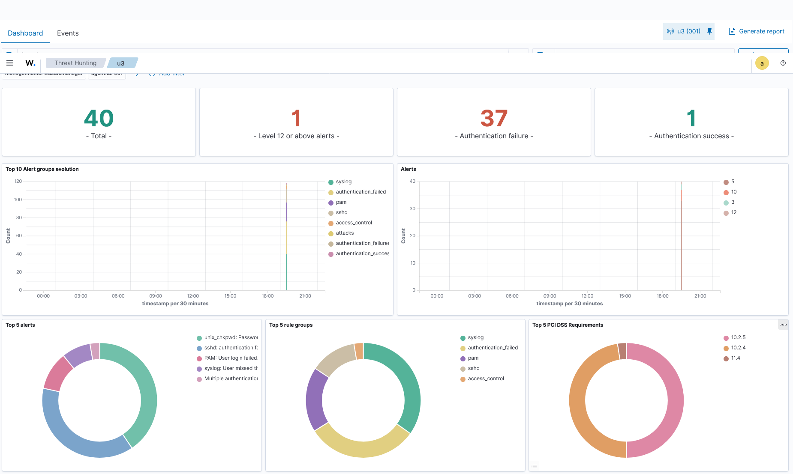
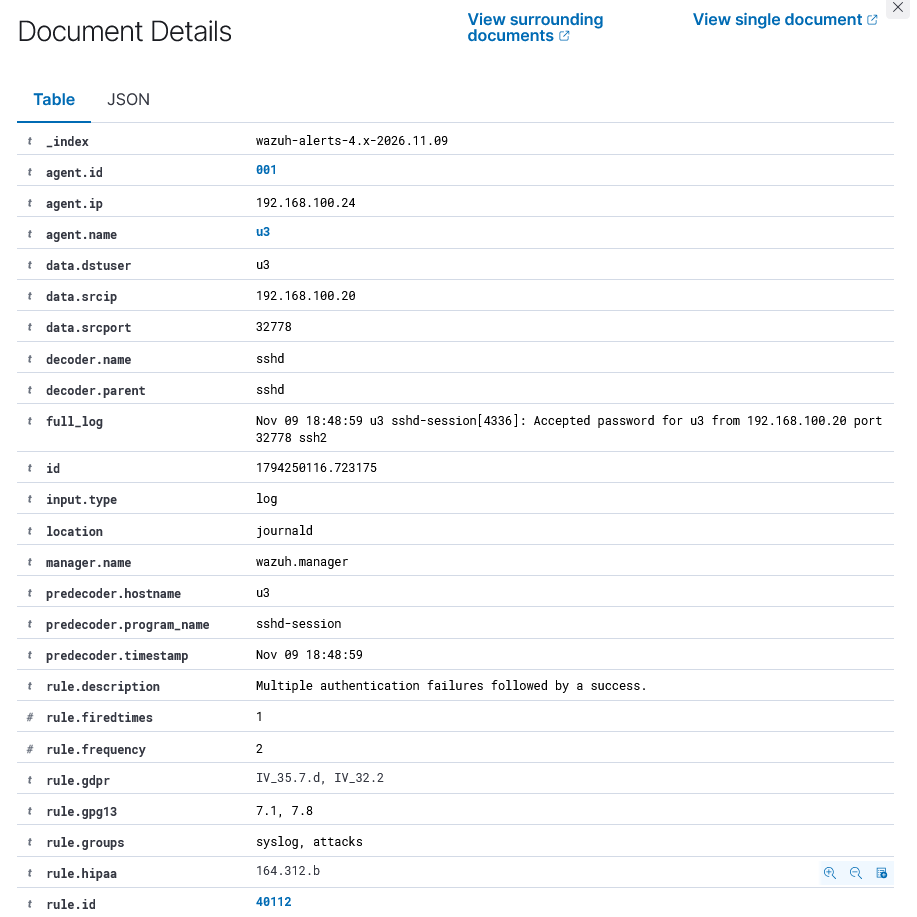
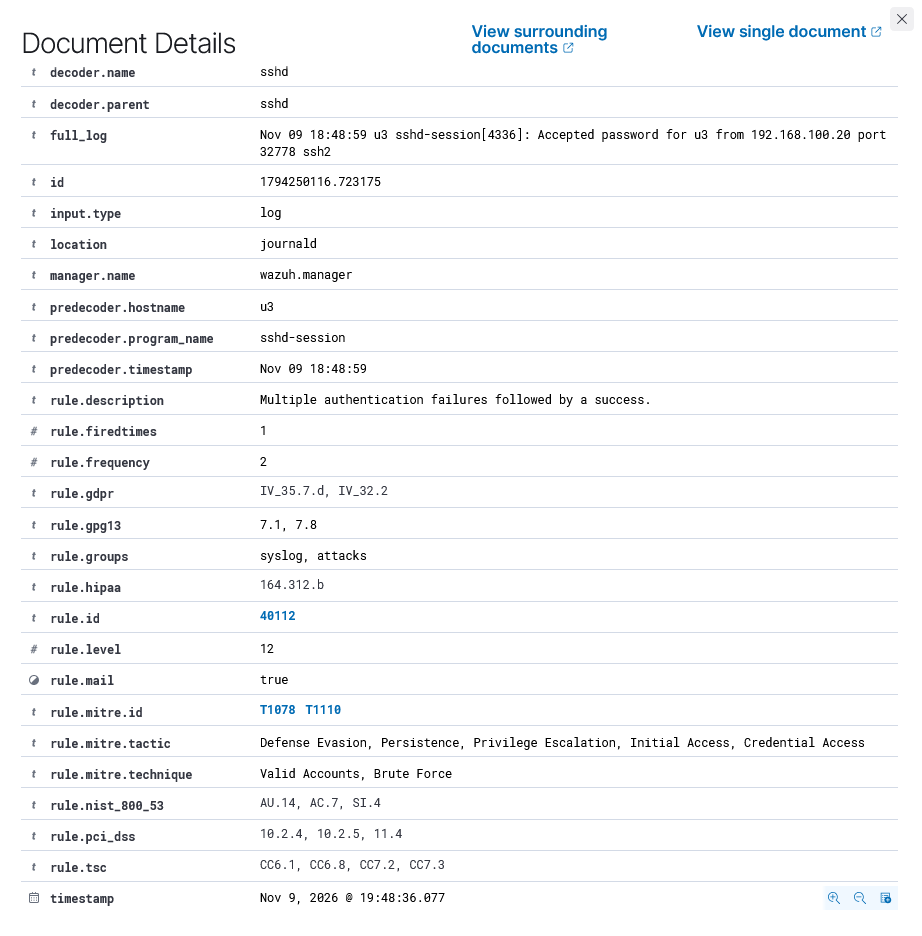

> [!NOTE]
> This is an educational home-lab case. All addresses, accounts, and passwords are fictional and used only in an isolated environment.

# SOC Practice #1 — SSH Brute-Force: From Attack to L1 Escalation

Hands-on case from a home lab. Full cycle: **attacker (Kali) → target (Ubuntu Server) → detection (Wazuh SIEM) → L1 triage → L2 escalation**.

## Metadata

| Field | Value |
|---|---|
| **Case ID** | SOC-2026-001 |
| **Date** | 2026-11-09 |
| **Difficulty** | Junior / L1 |
| **Domain** | SOC, Incident Response, Linux hardening |
| **MITRE ATT&CK** | T1110 Brute Force, T1078 Valid Accounts, T1021.004 Remote Services: SSH |
| **SIEM** | Wazuh 4.14 (single-node, Docker) |

## Summary

An attacker from an internal IP address performs an SSH password brute-force attack against an Ubuntu server. Because the standard user account has a weak password, the attack ends with a successful login. Wazuh triggers correlation rule **40112** — a burst of failed authentication attempts followed by a success.

The L1 analyst's goal is to confirm the attack, rule out a false positive, and prepare a complete fact package for L2.

---

## Lab Environment

| Role | VM | IP | OS / Software |
|---|---|---|---|
| Attacker | Kali Linux | `192.168.100.20` | Kali (rolling), hydra v9.x |
| SIEM | `u1` (not attacked) | `192.168.100.22` | Ubuntu Server 26.04, Wazuh 4.14 single-node (Docker) |
| Target | `u3` | `192.168.100.24` | Ubuntu Server, account `u3` with a weak password (intentional) |

Network: VirtualBox Host-only `192.168.100.0/24`, static IPs (`netplan` / `nmcli`). Wazuh agents are installed on the target host and on the SIEM server itself.

---

## Attack Scenario

SSH password brute-force using `hydra` and a small wordlist:

```bash
# Kali
printf "password\n123456\nqwerty\nletmein\nadmin\nroot\nubuntu\nwelcome\nabc123\nmonkey\ndragon\nmaster\nsunshine\niloveyou\ntrustno1\n1\n" > ~/lab-pass.txt
hydra -l u3 -P ~/lab-pass.txt -t 4 -V -I ssh://192.168.100.24
```

The password `u3:1` is in the wordlist — the attack succeeds on one of the last iterations.

> **Why the alert count is higher than the password count.**  
> The wordlist has ~16 entries, but Wazuh logged ~37 alert events. One failed SSH password attempt can produce multiple log lines (for example, `sshd` rule **5760** and `unix_chkpwd` rule **5557**), so the number of alerts is larger than the number of tried passwords.

### Why this works

- The target account `u3` has a **weak password** (`1`).
- SSH allows password authentication.
- There is no rate-limiting / fail2ban on the target host.

---

## Detection in Wazuh

The agent on `u3` forwards events to the SIEM. During the attack Wazuh reported **40 total alerts**, including **37 authentication failures** and **1 authentication success**:



Timeline of the correlation cycle (~2 seconds):

| Time (UTC) | Rule ID | Level | Description |
|---|---|---|---|
| 19:48:34 | 5760 | 5 | `sshd: authentication failed` |
| 19:48:36 | 5557 | 5 | `unix_chkpwd: Password check failed` |
| … | … | … | ~37 alert events in a row |
| 19:48:36 | 5501 | 3 | `PAM: Login session opened` — **login succeeded** |
| 19:48:36 | 5502 | 3 | `PAM: Login session closed` |
| 19:48:36 | 2502 | 10 | `User missed the password more than one time` |
| **2026-11-09T19:48:36.077Z** | **40112** | **12** | **«Multiple authentication failures followed by a success»** |

### Key alert

The key event is correlation rule **40112** at `2026-11-09T19:48:36.077Z`: a burst of failed authentication attempts followed by a success. This exact "failures → success" pattern is what separates brute-force from an ordinary user typo.





### MITRE ATT&CK mapping

- **T1110** Brute Force (Credential Access)
- **T1078** Valid Accounts — successful use of the compromised `u3` credentials (Defense Evasion / Persistence / Privilege Escalation / Initial Access)
- The follow-up SSH session maps to **T1021.004** Remote Services: SSH

---

## L1 Analyst Triage

L1 never logs into the server and changes nothing — the job is to confirm or rule out a false positive within 10–15 minutes and package the facts for L2.

1. **Validation.** 37 alert events in under 2 seconds is a machine pattern, not a human. A successful session immediately follows the failure burst.
2. **False-positive check.** `srcip 192.168.100.20` is an internal Kali host. In a real SOC, cross-check the asset inventory / authorized-scanner allowlists. Forgotten cron jobs and "user typos" are excluded by the pattern.
3. **Enrichment.** The target is a standard account `u3` on a test host; there are no anomalies on this host in the 24 hours before the incident; the post-success session is short (opened and closed within the same second — typical brute-force "did it work?" verification behavior).
4. **Verdict: true positive, P2** — successful brute-force.

### L1 checklist

- [ ] Confirm the pattern: N failed → 1 success.
- [ ] Check the source IP (internal / external, known host?).
- [ ] Check the target account (service / standard / privileged?).
- [ ] Check host alert history for the last 24 hours.
- [ ] Set severity: successful brute-force = P2.
- [ ] Prepare a ticket for L2.

---

## Escalation to L2 (Ticket Template)

```
[ESCALATION][P2] SSH brute-force SUCCESS on u3 (192.168.100.24)
Rule: 40112 "Multiple authentication failures followed by a success" (L12)
Time: 2026-11-09T19:48:36.077Z
Target: host u3 / account "u3"
Source: 192.168.100.20:32778 (internal — verify ownership in CMDB)
Evidence: ~37 alert events in <2s (5760/5557), then PAM session opened (5501)
Context: no prior alerts on host in 24h; account is a standard user
Requested: block 192.168.100.20 at firewall, force password reset for u3,
           review post-auth activity (last, auth.log, bash_history)
```

---

## Response (L2)

### Immediate containment

```bash
# On target (lab). In production — block at the perimeter firewall / VPN.
sudo iptables -A INPUT -p tcp -s 192.168.100.20 --dport 22 -j DROP
```

### Eradication & investigation

- **Force a password reset** for `u3`.
- **Review post-auth activity:**
  ```bash
  last
  sudo less /var/log/auth.log
  sudo less /home/u3/.bash_history
  ```
- Check for new user accounts, cron jobs, or SSH keys.

### Automation hardening

- Configure Wazuh Active Response (`firewall-drop` on rule 5712) to automatically block the source.
- Enable fail2ban / sshguard on the target host.
- Disable SSH password authentication and switch to keys.

---

## IOCs (lab)

| Type | Value |
|---|---|
| Source IP | `192.168.100.20` (Kali) |
| Target | `192.168.100.24:22` |
| Account | `u3` |
| Tool | hydra v9.x, ~16-password wordlist |
| Wazuh rule | 40112 (L12) |
| Indicators | ~37 alert events (mostly 5760/5557) within 2 seconds, then PAM session opened (5501) |

---

## Takeaways

- The "N failures + success" correlation is a basic but reliable brute-force detection; rule 40112 catches hydra out of the box, even with `-t 4`.
- The most valuable part of the alert is not the failures themselves but the **successful session after them** — that's what turns noise into an incident.
- L1 = triage and routing: the entire value is a correct verdict and a complete fact package for L2.
- Bonus infrastructure lesson: a SIEM must be protected from itself — Wazuh's vulnerability-scanner feed (~9GB) plus an event queue ballooning on a dead indexer filled the lab's 30GB disk and took the whole stack down. Prevention: disable vulnerability-detection on small labs, rotate container logs, use `restart: always`, and keep VM snapshots.

---

## References

- [Wazuh ruleset — SSH](https://documentation.wazuh.com/current/user-manual/ruleset/ruleset.html)
- [MITRE ATT&CK T1110 — Brute Force](https://attack.mitre.org/techniques/T1110/)
- [MITRE ATT&CK T1021.004 — Remote Services: SSH](https://attack.mitre.org/techniques/T1021/004/)
- [OWASP Testing for Brute Force](https://owasp.org/www-project-web-security-testing-guide/latest/4-Web_Application_Security_Testing/04-Authentication_Testing/04-Testing_for_Brute_Force.html)
