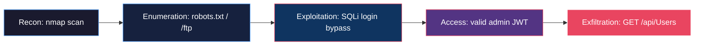

> **Note:** This is an educational home-lab case. All addresses, accounts, and tokens are fictional and used only in an isolated environment.

# Case 02 — Juice Shop Web Attack: Recon → Path Traversal → SQLi → Data Exfiltration

Full-cycle home-lab incident: attacker (Kali) → target (Ubuntu Server + OWASP Juice Shop) → detection (Wazuh + Suricata) → L1 triage → L2 escalation.

## Metadata

| Field | Value |
|---|---|
| Case ID | SOC-2026-002 |
| Date | 2026-11-09 |
| Difficulty | Junior / L1 |
| Domain | SOC, Web Application Security, Incident Response |
| MITRE ATT&CK | T1595, T1046, T1083, T1190, T1078, T1005 |
| SIEM | Wazuh 4.14 (single-node, Docker) + Suricata (IDS mode, eve.json → Wazuh agent) |

## Summary

An attacker from an internal IP runs a full kill-chain against a deliberately vulnerable web application (OWASP Juice Shop): port scanning, HTTP enumeration, path traversal to a hidden `/ftp` directory, SQL injection in the login form resulting in an admin JWT, and finally mass exfiltration of the user database via an authenticated admin API call.

The L1 analyst's goal is to correlate the alert sequence into **one incident**, separate recon from confirmed compromise, and package facts for L2 — including a discovered **visibility gap** (API traffic with a stolen token is not detectable with current logging).

## Kill-chain view

## Lab Environment

| Role | VM | IP | OS / Software |
|---|---|---|---|
| Attacker | Kali Linux | 192.168.100.20 | Kali (rolling), nmap 7.99, curl |
| SIEM | u1 | 192.168.100.22 | Ubuntu Server, Wazuh 4.14 single-node (Docker), Suricata |
| Target | u3 | 192.168.100.24 | Ubuntu Server, nginx/1.28.3, OWASP Juice Shop, Wazuh agent id `001` |

Network: VirtualBox Host-only `192.168.100.0/24`. Wazuh agent + Suricata sensor on the target host forward events to the SIEM.

## Case modules

| Module | What is inside |
|---|---|
| [attack.md](attack.md) | Reconnaissance and exploitation commands, phase by phase |
| [detection.md](detection.md) | What the SIEM saw: timeline, rule breakdown, Suricata example, MITRE mapping, screenshots |
| [triage.md](triage.md) | L1 triage logic and checklist |
| [templates/escalation.md](templates/escalation.md) | Full L2 escalation ticket with impact, evidence, visibility gap, and requested actions |
| [response.md](response.md) | Containment, eradication, and hardening recommendations |
| [lessons.md](lessons.md) | Key takeaways for a junior analyst |
| [iocs/README.md](iocs/README.md) | Artifacts and indicators of compromise |

## Quick verdict

**True positive, P1/P2 — confirmed web compromise with PII exfiltration.**

All activity from `192.168.100.20` maps to a single kill-chain: recon → enumeration → exploitation → exfiltration. The final `GET /api/Users` step was not visible in the SIEM and is documented as a visibility gap.
