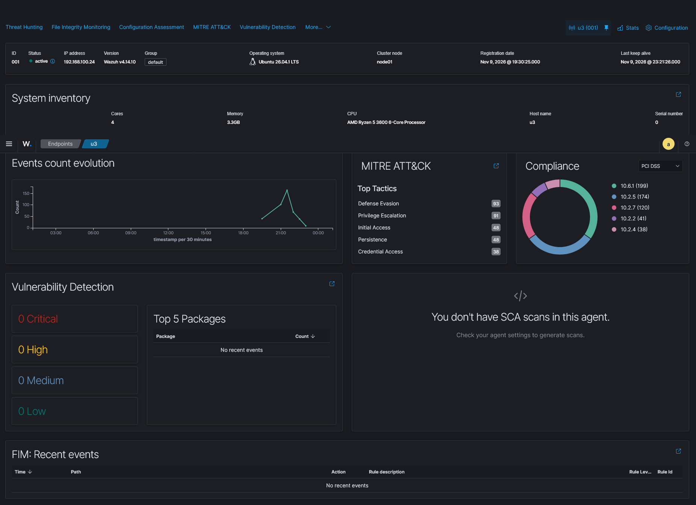

> Back to [case summary](README.md)

# Detection

> **Note on timestamps:** The original lab notes used approximate times. The Wazuh event export used for this case covers **2026-11-09 22:17:54 – 23:09:50 UTC**; the PDF Threat Hunting report covers **2026-11-09T22:16:00 – 2026-11-10T01:11:28**. The timeline below is aligned with the exported alert data.

## What the SIEM saw

| # | Time (UTC) | Event | Source | Detection |
|---|---|---|---|---|
| 1 | 22:37:03 – 23:09:50 | Scan / recon activity from `192.168.100.20` | Suricata | 25× rule **86601** (ET SCAN / ET HUNTING curl/Nmap user-agents, port probes) |
| 2 | 22:35:29 | System audit events on target | Wazuh agent | 7× rule **516** |
| 3 | 22:35:40 – 22:37:13 | Interactive PAM sessions | Wazuh agent | 3× `PAM: Login session opened` (**5501**), 4× `PAM: Login session closed` (**5502**) |
| 4 | 22:37:03 | SQL injection attempt in login form | Wazuh agent / Suricata | 1× rule **31164** — `SQL injection attempt` (L6) |
| 5 | 23:00:08 | nginx error message | nginx error log | 1× rule **31301** |
| 6 | 23:09:50 | Web server 500 Internal Error | Wazuh agent | 1× rule **31122** (L5) |
| 7 | shortly after 22:37 | GET `/api/Users` with stolen Bearer token | **NOT VISIBLE in SIEM** | ⚠️ visibility gap — valid admin JWT usage looks like normal traffic |

## Event breakdown (from raw Wazuh export)

| Count | Rule ID | Level | Description |
|---|---|---|---|
| 25 | 86601 | 3 | Suricata: Alert — ET SCAN / ET HUNTING user-agents and port probes |
| 7 | 516 | 3 | System Audit event |
| 4 | 5502 | 3 | PAM: Login session closed |
| 3 | 5501 | 3 | PAM: Login session opened |
| 2 | 5402 | 3 | Successful sudo to ROOT executed |
| 1 | 31164 | 6 | SQL injection attempt |
| 1 | 31122 | 5 | Web server 500 error code (Internal Error) |
| 1 | 31301 | 3 | Nginx error message |
| 1 | 5403 | 4 | First time user executed sudo |
| 1 | 81101 | 3 | Attached USB Storage |
| 1 | 81102 | 3 | USB device disconnected |
| 1 | 503 | 3 | Wazuh agent started |
| 1 | 506 | 3 | Wazuh agent stopped |

**Total:** 49 alert events in the exported window.

## Notable alert timestamps

| Rule ID | Time (UTC) | Description |
|---|---|---|
| 506 | 22:17:54.000 | Wazuh agent stopped |
| 503 | 22:35:22.859 | Wazuh agent started |
| 5502 | 22:35:28.051 | First `PAM: Login session closed` |
| 516 | 22:35:29.097 | First `System Audit event` |
| 5501 | 22:35:40.959 | First `PAM: Login session opened` |
| 5403 | 22:35:40.959 | First time user executed sudo |
| 5402 | 22:35:40.966 | Successful sudo to ROOT |
| 81102 | 22:40:11.590 | USB device disconnected |
| 81101 | 22:40:13.578 | Attached USB Storage |
| 31164 | **22:37:03.004** | **SQL injection attempt** |
| 86601 | 22:37:03.008 | First Suricata scan/recon alert |
| 31301 | 23:00:08.331 | Nginx error message |
| 31122 | 23:09:50.657 | Web server 500 Internal Error |

## Key alert example (Suricata → Wazuh)

```json
"alert": {
  "signature": "ET SCAN Suspicious inbound to MSSQL port 1433",
  "signature_id": "2010935",
  "severity": "2",
  "action": "allowed",
  "category": "Potentially Bad Traffic"
},
"src_ip": "192.168.100.20", "dest_ip": "192.168.100.24", "dest_port": "1433",
"flow": { "pkts_toserver": "1", "pkts_toclient": "0" }
```

**Analyst reading:** 1 packet to server, 0 to client, severity Informational → this is a *port probe during a scan*, **not** evidence that MSSQL is open. Correlated with scan results, port 1433 answered RST. Alert ≠ fact.

## Evidence

- [`iocs/wazuh-events.csv`](iocs/wazuh-events.csv) — raw 49-event Wazuh export used for counts and timestamps.
- [`iocs/wazuh-threat-hunting-report.pdf`](iocs/wazuh-threat-hunting-report.pdf) — 5-page Wazuh Threat Hunting report for agent `001`.
- [`iocs/screenshots/wazuh-agent-overview.png`](iocs/screenshots/wazuh-agent-overview.png) — agent dashboard screenshot (events evolution + MITRE tactics).



### Raw export sample

First and last lines of the Wazuh event export used for this case:

```csv
timestamp,agent.name,rule.description,rule.level,rule.id
"Nov 9, 2026 @ 22:17:54.000",u3,Wazuh agent stopped.,3,506
...
"Nov 9, 2026 @ 23:09:50.679",u3,sshd: authentication failed.,5,86601
```

Full file: [`iocs/wazuh-events.csv`](iocs/wazuh-events.csv).

## MITRE ATT&CK Mapping

- **T1595.002 Active Scanning: Vulnerability Scanning** — nmap SYN scan
- **T1046 Network Service Discovery** — port/service enumeration
- **T1083 File and Directory Discovery** — `/ftp` enumeration via robots.txt
- **T1190 Exploit Public-Facing Application** — path traversal + SQLi (Juice Shop)
- **T1078 Valid Accounts** — use of the forged admin JWT
- **T1005 Data from Local System** — `/api/Users` dump (PII exfiltration)
