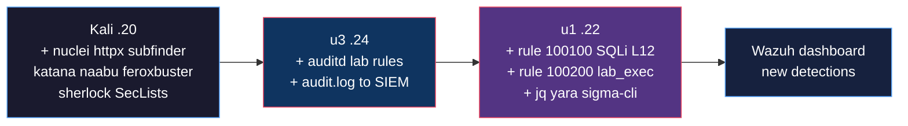

> **Note:** This is an educational home-lab case. All addresses, accounts, and passwords are fictional and used only in an isolated environment.

# Case 03 — Lab Upgrade: Arsenal & Telemetry

This one isn't an attack case. It's an infrastructure case: one maintenance window upgrades all three lab roles. The attacker gets a modern offensive toolchain, the victim gets syscall-level telemetry it never had, and the SIEM gets a tested detection-engineering package. Every future case (SOC-2026-004+) builds on this baseline.

## Metadata

| Field | Value |
|---|---|
| Case ID | SOC-2026-003 |
| Date | 2026-11-14 |
| Difficulty | Junior / L1 (lab engineering) |
| Domain | SOC lab ops, detection engineering, toolchest |
| MITRE ATT&CK | n/a (infrastructure); enables detection of T1059, T1190, T1078 |
| SIEM | Wazuh 4.14 (single-node, Docker) |

## Summary

SOC-2026-002 ended with three documented gaps: manual-only recon, no syscall telemetry on the victim, and SQLi visible only as raw nginx events. This upgrade closes all three:

- **Kali (.20)**: ProjectDiscovery stack + feroxbuster + sherlock + SecLists: the toolchain real offensive teams use, replacing one-off scripts.
- **u3 (.24)**: `auditd` with a lab rule set, shipped to the SIEM through the Wazuh agent. Post-compromise activity (commands, config tampering, planted keys) becomes visible.
- **u1 (.22)**: custom escalation rule **100100** (SQLi → L12) applied to the manager and verified with `wazuh-logtest`; analyst utils installed.

## Upgrade map

## Lab Environment

Same network as SOC-2026-001/002: VirtualBox Host-only `192.168.100.0/24`, static IPs.

| Role | VM | IP | Changes in this case |
|---|---|---|---|
| Attacker | Kali | `192.168.100.20` | + nuclei, httpx, subfinder, katana, naabu, feroxbuster, sherlock, SecLists |
| SIEM | u1 | `192.168.100.22` | + local rules 100100/100200, jq, yara, sigma-cli |
| Target | u3 | `192.168.100.24` | + auditd, agent now ships `/var/log/audit/audit.log` |

## Sections

- [attacker.md](attacker.md): Kali stack, versions, verification run
- [telemetry.md](telemetry.md): u3 auditd rules, agent config, pitfalls
- [siem-package.md](siem-package.md): u1 rules (with logtest evidence), analyst utils
- [lessons.md](lessons.md): what this upgrade taught

## What changes for future cases

| Before | After |
|---|---|
| Recon by hand / nmap only | Full PD pipeline in one line: `subfinder \| httpx \| nuclei` |
| Post-compromise = blind | `lab_exec` audit trail: command timelines in SIEM |
| SQLi visible only as raw nginx events | Dedicated alert at **level 12** with MITRE T1190 |
| Wordlists ad-hoc | SecLists standard paths in every command |

**Immediate candidate cases:** SOC-2026-004 "automated scanning vs signature detection" (nuclei burst against u3, watch Suricata and rule 100100 light up together), SOC-2026-005 "post-exploitation command timeline" (SSH in as u3, run commands, reconstruct from `lab_exec`).
