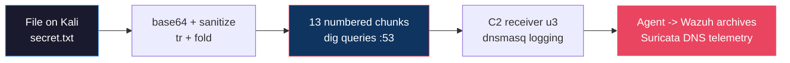

> [!NOTE]
> This case is a **draft** — sections marked TODO are being written.
> Educational home-lab case. All addresses, accounts and passwords are fictional
> and used only in an isolated environment.

# SOC Practice #04 — DNS Exfiltration: From Attack to L1 Escalation

Hands-on case from a home lab. Full cycle: **attacker (Kali) → receiving "C2" host (u3) →
detection (Wazuh archives + Suricata) → L1 triage → L2 escalation**.

## Metadata

| Field | Value |
|---|---|
| **Case ID** | SOC-2026-004 |
| **Date** | 2026-11-18 |
| **Difficulty** | Junior / L1 |
| **Domain** | SOC, DNS tunneling, Network Security |
| **MITRE ATT&CK** | T1071.004 Application Layer Protocol: DNS, T1048 Exfiltration Over Alternative Protocol |
| **SIEM** | Wazuh 4.14 (single-node, Docker) + Suricata 8.x IDS |
| **Status** | 🚧 Draft (attack + summary done; detection/triage in progress) |

## Summary

Between 00:04:34–00:04:36 local (CET, UTC+1), host `192.168.100.20` sent 12–13 DNS
requests to `192.168.100.24:53` for the domain `exfil.lab`, with suspicious
subdomains in the requests. The subdomains carried parts of base64-encoded data —
chunks of a file, ~50 characters each, numbered 0–12: e.g.
`0.o8h0ozjefad7nfwtjnomoaaq5xjx6ixlnun8jt8tnnxryoyc2x.exfil.lab`.

No alerts fired for this time window. The activity was found manually in
`wazuh-archives-*` via basic log monitoring — two independent sources saw it:
the dnsmasq query log on the receiving host and Suricata DNS telemetry.

**Verdict: true positive, P2** — data exfiltration over DNS is confirmed.
Recommended: hand to L2 to investigate the scope and decode the subdomain contents
(trivial, as the data is only encoded, not encrypted).

## Kill-chain view

## Lab environment

| Role | VM | IP | OS / Software |
|---|---|---|---|
| Attacker | Kali | `192.168.100.20` | Kali rolling, bash, dig |
| Receiver ("C2") | u3 | `192.168.100.24` | Ubuntu Server, dnsmasq (query logging) |
| SIEM | u1 | `192.168.100.22` | Wazuh 4.14 single-node (Docker), Suricata 8.x on u3 |

Note: in this lab simulation the receiving side sits in the same network. In a
real scenario the chunks fly to the attacker's authoritative nameserver — the one
published in the domain's NS record — reached through the victim's own resolvers.

## Case modules

| Module | Status |
|---|---|
| [01-attack.md](01-attack.md) | ✅ Done (tool, execution, why it worked) |
| 02-detection.md | 🚧 TODO (timeline, archive hunt, two sources) |
| 03-triage.md | 🚧 TODO (L1 checklist, escalation) |
| iocs/ | 🚧 TODO |

## Quick verdict

**True positive, P2 — confirmed DNS-based data exfiltration: a file left the
`192.168.100.20` host encoded into DNS queries, and no alert fired.**
