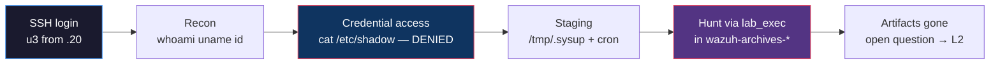

# SOC Practice #05 — Post-Exploitation Hunt: SSH Compromise & Persistence via auditd telemetry

> [!NOTE]
> Educational home-lab case. All addresses, accounts and passwords are fictional
> and used only in an isolated environment.

Hands-on case from a home lab. Full cycle: **attacker (Kali) → target (u3 over SSH) →
detection (auditd lab_exec telemetry in Wazuh archives) → L1 triage → L2 escalation**.

## Metadata

| Field | Value |
|---|---|
| **Case ID** | SOC-2026-005 |
| **Date** | 2026-11-21 |
| **Difficulty** | Junior / L1 (elements of L2 hunting) |
| **Domain** | SOC, DFIR, Linux forensics, incident response |
| **MITRE ATT&CK** | T1078 Valid Accounts, T1033 System Owner/User Discovery, T1082 System Information Discovery, T1003.008 OS Credential Dumping: /etc/passwd & /etc/shadow, T1053.003 Scheduled Task/Job: Cron, T1036 Masquerading, T1070 Indicator Removal |
| **SIEM** | Wazuh 4.14 (single-node, Docker) + auditd `lab_exec` syscall telemetry + Velociraptor EDR |
| **Status** | ✅ Ready (one open question documented, see Detection) |

## Summary

An SSH session from `192.168.100.20` to `192.168.100.24` (u3) at 00:13:34Z shows a
classic post-compromise pattern: immediate system recon (`whoami; hostname;
uname -a; id`), an attempt to read `/etc/shadow` (**denied**), and staging of a
persistence mechanism (a hidden script `/tmp/.sysup` with a cron entry). The
activity was found by hunting `lab_exec` auditd events in `wazuh-archives-*` —
**no alert rule fired for the attack itself** (the telemetry is archive-only);
the only rule involved was the custom lab rule 100200 that surfaces process
execution at level 10. One open question is preserved honestly: by the time
live checks ran, the staged artifacts were gone from the host (anti-forensics
or lab artifact — flagged for L2).

**Verdict: true positive, P2** — confirmed unauthorized access and attempted
credential access; persistence staged; nothing confirmed stolen.

## Kill-chain view

## Lab environment

| Role | VM | IP | OS / Software |
|---|---|---|---|
| Attacker | Kali | `192.168.100.20` | Kali rolling, sshpass |
| Target | u3 | `192.168.100.24` | Ubuntu Server, auditd (`lab_exec`), Suricata, Wazuh agent `001` |
| SIEM | u1 | `192.168.100.22` | Wazuh 4.14 single-node (Docker), Velociraptor server |

## Case modules

| Module | Status |
|---|---|
| [01-attack.md](01-attack.md) | ✅ Red side: three-phase SSH scenario |
| [02-detection.md](02-detection.md) | ✅ Hunt narrative: analyst findings, two telemetry sources, timezone pitfall |
| [03-triage.md](03-triage.md) | ✅ L1 reasoning: validation → verdict |
| [04-response.md](04-response.md) | ✅ Containment, eradication, hardening |
| [05-lessons.md](05-lessons.md) | ✅ What this case teaches |
| [templates/escalation-short.md](templates/escalation-short.md) | ✅ Filled L2 ticket |
| [iocs/](iocs/) | ✅ Raw analyst notes, attacker script, timeline |

## Quick verdict

**True positive, P2 — confirmed unauthorized SSH session with recon, attempted
credential access (denied) and staged persistence; nothing confirmed exfiltrated
or dumped. Escalated with an open question on vanished artifacts.**
